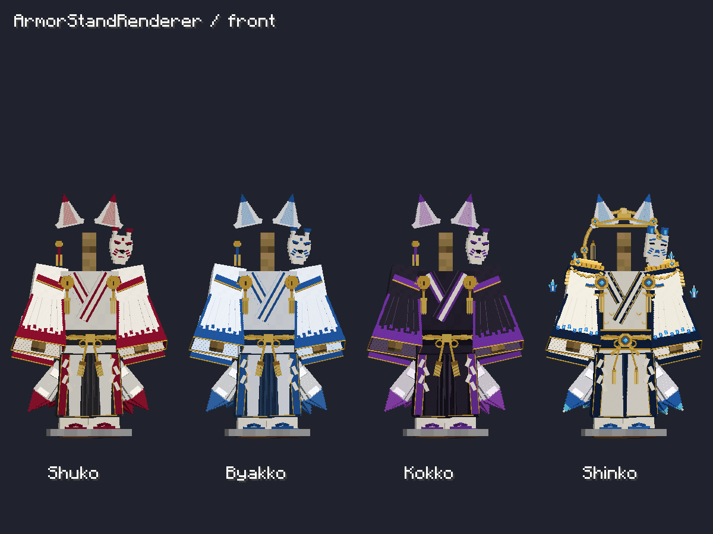
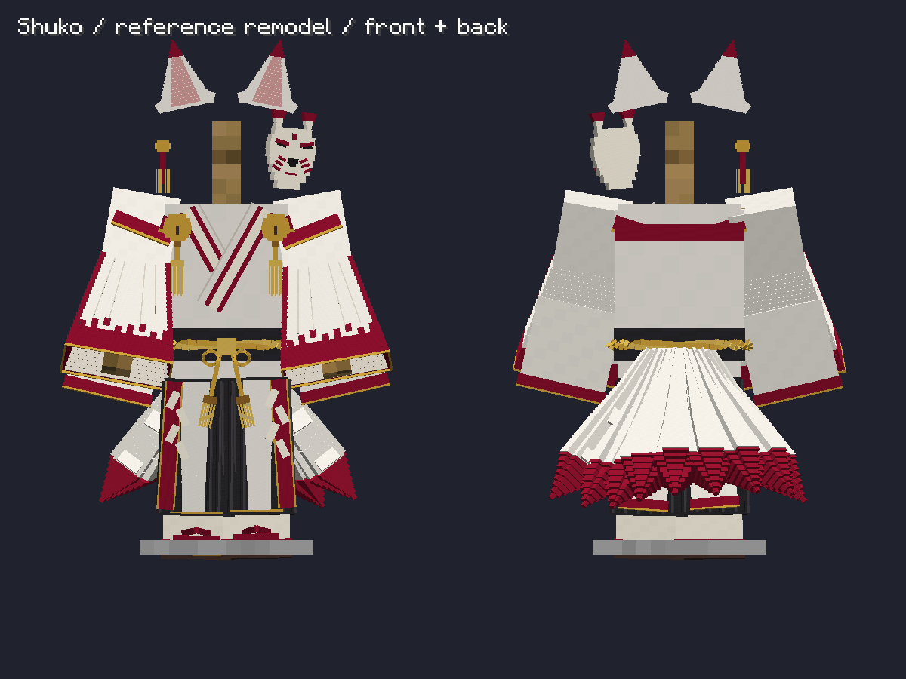
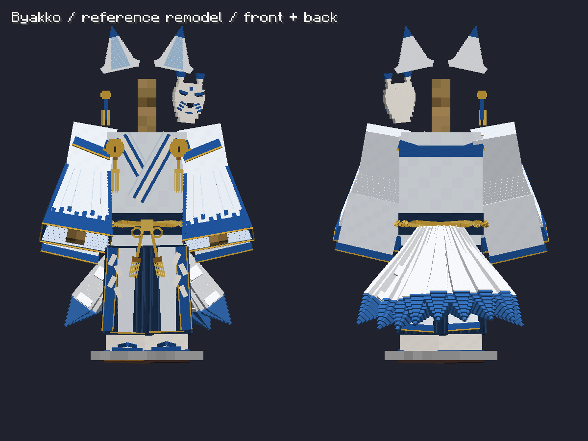
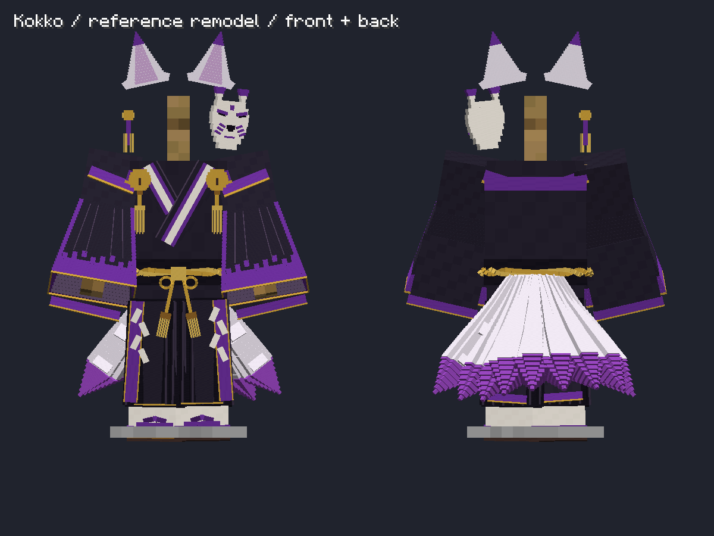
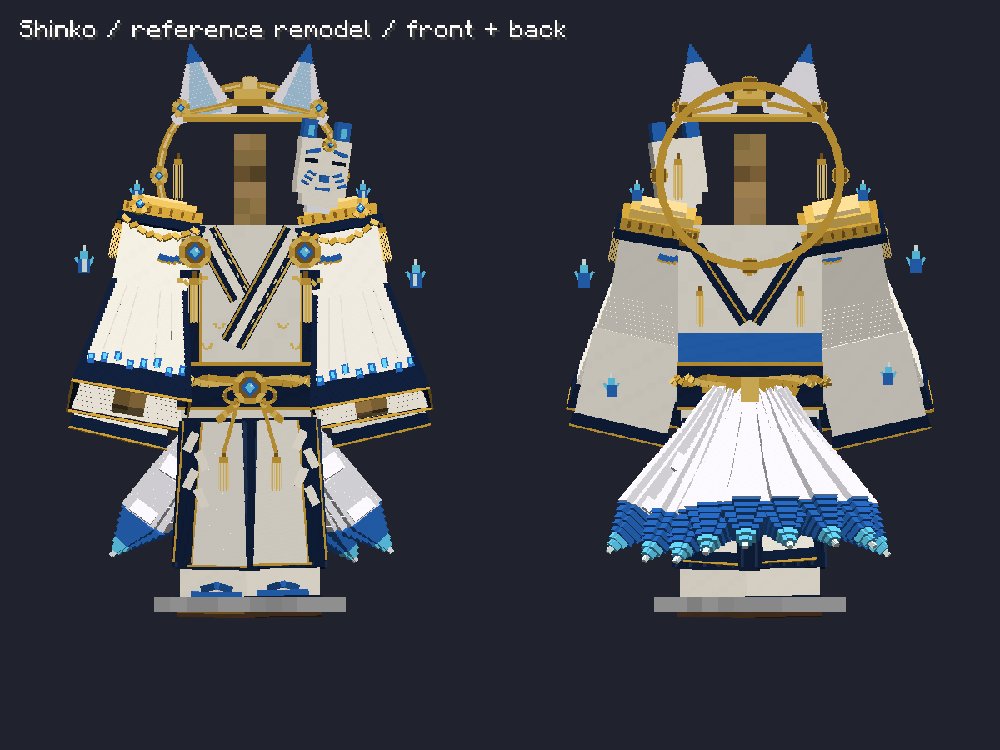

# 4種の妖狐防具：詳細案に基づく再モデリング

2026-10-21。対象は Minecraft 1.21.1 NeoForge / Fabric。ユーザー添付の上半身・全身モデリング詳細案を参照し、朱狐（Shuko）、白狐（Byakko）、黒狐（Kokko）、神狐（Shinko）の着用形状を調整した。

## 今回の造形変更

- 狐耳：細長い角状の形から、幅のある三角形と内耳・根元の毛束へ変更。
- 仮面：朱狐・白狐・黒狐の頬と顎を先細りにし、眉・頬の隈取り、鼻、耳を分けて造形。白い陶器部分を色違いでも維持。
- 胸元：白い布の重なりに色付きの襟を載せ、肩帯、丸い鈴、房を立体化。神狐の金輪・金の肩飾り・宝玉は専用形状を維持。
- 袖：裾へ連続的に広がる24断面の中空袖。外布・裏地・細い襞・縁取り・後ろへ垂れる布を分離。
- 腰：前だけの平たい組紐を、側面・背面まで回る二本の立体的な組紐と結びへ変更。
- 袴：足首付近までの長さとし、前後に傾斜した面を持つ襞を配置。長い前垂れ、色付きの外縁、紙垂、背面の布を追加。
- 足元：白足袋、割れた爪先、V字の鼻緒、重なった木製の台を造形。
- 尻尾：平たい毛束の板から、八角形の断面を持ち、付け根から太くなって先端が細くなる形へ変更。装備数による0・1・3・6・9本、下向きの基本姿勢と揺れを維持。

同一位置の面を避け、袖の角は面を重ねず接続する。断面の微小な重なりも除いた。以前修正した、GeckoLibの薄い装飾用の非退化・余白付きUVは維持。

朱狐・白狐・黒狐は同一形状と各色の128pxパレット。神狐は専用装飾を含む別形状と256pxパレット・発光マスク。編集用データ全体では前者366ボーン・1,864立方体、後者645ボーン・2,314立方体。全9本の尻尾を含む数であり、ゲーム内では装備スロットと尻尾本数に応じて表示部分を選ぶ。GeckoLib形式には足のアンカーが2個加わる。

髪・顔はプレイヤースキンを使用する。画像の白髪やキャラクターの顔は防具に追加しない。詳細案は寸法図ではないため、隠れた面や布の寸法は着用可能な形に補っている。照明、布の柔らかさや画像生成特有の細部まで一致させたものではない。物理的な布シミュレーションは追加していない。

## 編集用データと再生成

旧モデル・生成器は上位の `../Kitsunebi-Archive/2026-10-21/reference-remodel-before/` に保存。元の `armor_geometry.json` と元テクスチャは保持する。

- 共通の形状調整：`fox_reference_shapes.py`
- 朱狐・白狐・黒狐の原本：`generate-shuko-detailed.py` → `models/shuko_detailed.json`
- 神狐の原本：`generate-shinko-detailed.py` → `models/shinko_detailed.json`
- GeckoLib：`convert-shuko-gecko.py` → NeoForgeの `geo/shuko_armor.geo.json` / `geo/shinko_armor.geo.json`
- Fabric：`export-fox-humanoid.py` / `export-shinko-assets.py` → 共通の `KitsunebiArmorVisualModel.java` / `ShinkoArmorVisualModel.java`
- 色・アイコン：`generate-fox-variants.py` / `export-shinko-assets.py`

リポジトリ直下から順に実行する：

```powershell
python docs/v04-codex/generate-shuko-detailed.py
python docs/v04-codex/generate-shinko-detailed.py
python docs/v04-codex/convert-shuko-gecko.py
python docs/v04-codex/convert-shuko-gecko.py --family shinko
python docs/v04-codex/generate-fox-variants.py
python docs/v04-codex/export-fox-humanoid.py
python docs/v04-codex/export-shinko-assets.py
.\Build.ps1 -Target neoforge-1.21.1
.\Build.ps1 -Target fabric-1.21.1
```

元の装備ID、能力、レシピ、装備数判定は今回変更していない。Forge 1.20.1 / 26.xへの形状移植は含まない。NeoForgeのGeckoLibは4.9.3、Fabricは既存のネイティブ防具描画を使用する。

## 検証と確認画像

以下の検査はすべてPASS。NeoForge / Fabric両方のビルドは成功し、共有リリースフォルダーのJAR内容（モデル・4種のパレット・16アイテム・6言語）とSHA256SUMSも照合済み。

- NeoForgeの実GeckoLibレンダラー：4種それぞれ全16通りの装備組み合わせ、着脱、混在、尻尾の0・1・3・6・9本と一重描画、UVの退化・パレット境界チェック。
- Fabricのネイティブ防具描画：4種それぞれ全16通り、混在、正面・側面・背面、尻尾本数と重複抑制。
- NeoForgeの実PlayerRenderer：4種の正面・側面・背面、歩行・走行・しゃがみ・ジャンプ・水泳・エリトラ・騎乗の強制姿勢、標準・スリムの不透明スキンの被覆検査。
- NeoForgeの実ArmorStandRenderer：4種比較、各種の正面・背面と上半身拡大を撮影して目視確認。

姿勢の強制描画検査は、実際の移動物理の検証ではない。今回の新形状での複数プレイヤー通信試験、長時間プレイ、多数の装備者を同時表示した性能計測、シェーダーMod併用は未検証。立方体の細分化により曲面に小さな段差が残る。遠距離用のモデル簡略化は未実装。

ログはNeoForgeの `build/reference-remodel-final-render.log`、`build/reference-remodel-final-poses.log`、`build/reference-remodel-build.log`。検証結果は各実行ディレクトリの `gecko-verification.txt`、`gecko-player-poses.txt`、Fabricの `fox-armor-verification.txt`。











上半身拡大： [朱狐](reference-shuko-head-torso.png) / [白狐](reference-byakko-head-torso.png) / [黒狐](reference-kokko-head-torso.png) / [神狐](reference-shinko-head-torso.png)。

## 確認用JARと起動

- NeoForge：`releases/preview/1.21.1/neoforge/1.0.0/kitsunebi-neoforge-1.21.1-1.0.0-gecko-preview.jar`
- Fabric：`releases/1.21.1/fabric/1.0.0/kitsunebi-fabric-1.21.1-1.0.0.jar`

通常の開発クライアント起動は `.\RunClient.ps1 -Target neoforge-1.21.1` または `.\RunClient.ps1 -Target fabric-1.21.1`。NeoForgeの外部ランチャーにはArchitectury APIとGeckoLib 4.9.3が必要。
