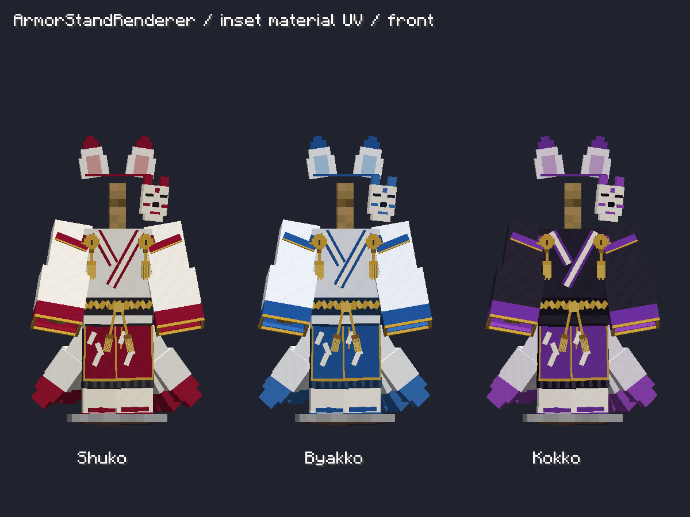
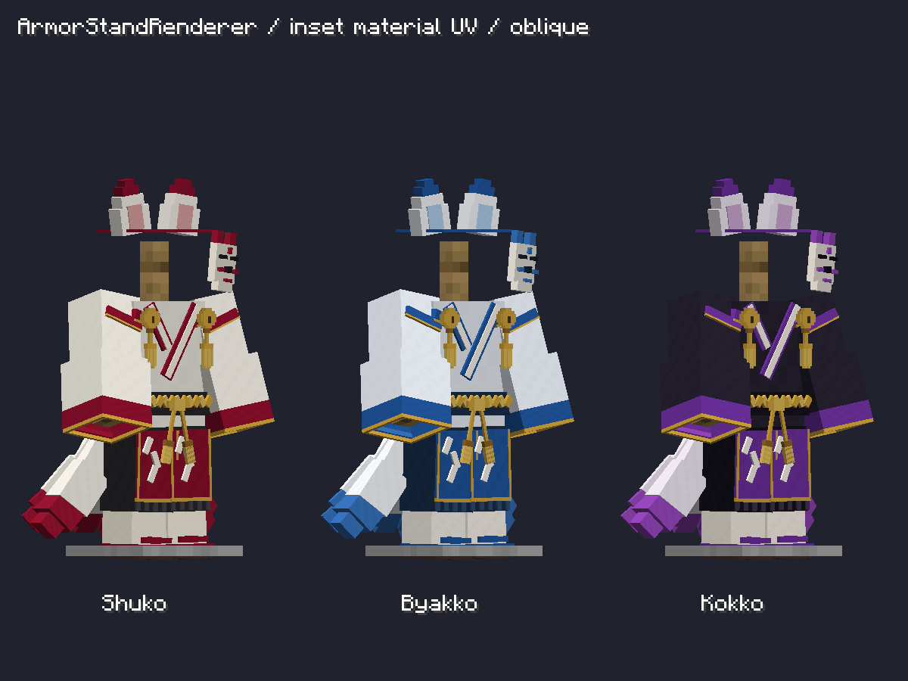

# 防具の斑点状ちらつき修正

2026-10-21。Shuko / Byakko / Kokko共通。

利用者の防具立て画像では、重ね襟・紙垂・仮面・房飾り・袖口などに異なる色の斑点が出ていた。

## 原因と修正

GeckoLib 4.9.3の公式sources JARにある `BakedModelFactory.buildQuad` を確認したところ、box UVは各寸法を `Math.floor` してUVの大きさを計算する。防具には幅や厚さが1px未満の装飾が多く、UVが幅0／高さ0へ潰れ、32pxパレット区画の境界そのものを参照していた。補間の丸め誤差で隣の色を拾うため、高コントラストなちらつきになる。

- GeckoLibモデルのbox UVを廃止し、各面に明示的なUVを設定。32×32pxの色区画の内側1〜31pxを使用し、幅・高さを常に確保する。
- FabricネイティブモデルのUV開始点も1px内側へ移す。
- 耳の土台はネイティブUVの最大展開幅が区画内に収まるよう奥行きを0.4px調整。
- 重ね襟の白い帯と下地の間隔を増やす。帯の組紐は前後を交互に0.08pxずらし、同一平面に重なる部分のZ-fightingも抑える。
- 共通の編集用モデルから、3色のアイコンと両ローダーの装備モデルを再生成。能力・レシピは変更しない。

## 検証

`GeckoArmorVerifier` に、実際にベイクされた全頂点のUVが色区画の境界上にないこと、各面のUV幅・高さが0でないことを確認する回帰チェックを追加した。

利用者の表示条件に合わせ、実 `ArmorStandRenderer` に3色のフルセットを装備した正面・斜めの撮影ケースを追加。通常のプレイヤー姿勢・スキン外層・装備組み合わせの既存検証も使用する。

実行ログ：NeoForgeの `build/fox-uv-fix.log`。

実行結果：3色と色混在の全装備パターン、全ベイク面のUV検査、プレイヤー姿勢・スキン外層検査、防具立ての正面・斜め撮影が成功。撮影画像を目視し、報告画像にあった高コントラストな斑点が消えたことを確認。NeoForge・Fabricの描画検証およびビルドが成功。

最終ログ：`build/fox-uv-final-check.log`、`build/fox-uv-release.log`。修正版JARは従来と同じ `releases/preview/1.21.1/neoforge/1.0.0/` および `releases/1.21.1/fabric/1.0.0/` へ配置する。

