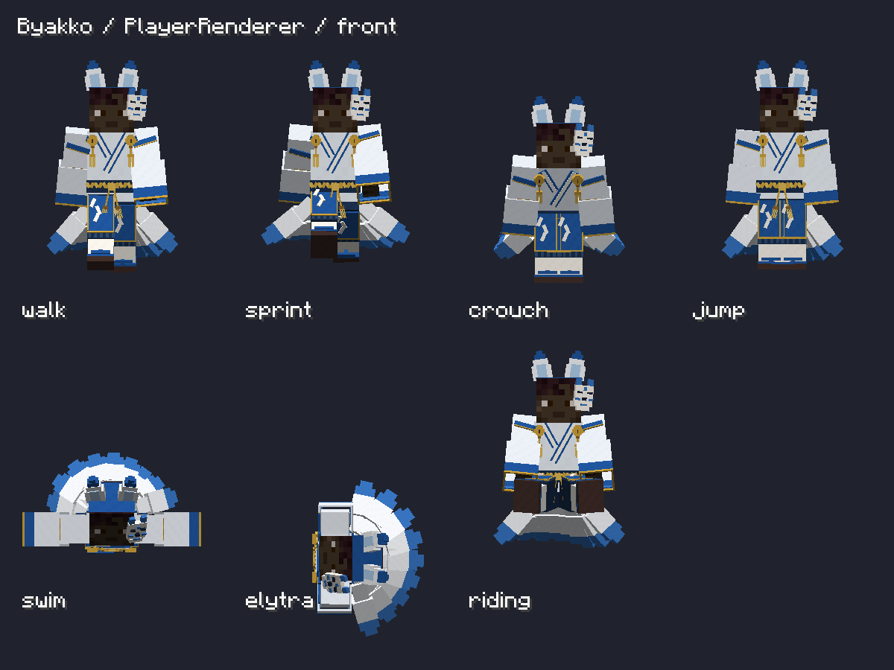
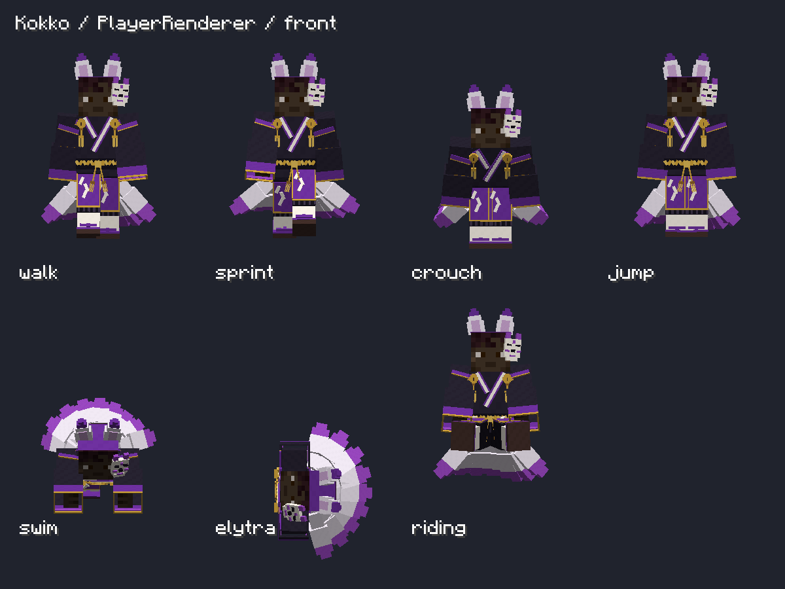

# 朱狐・白狐・黒狐（1.21.1）

**最新の造形・画像は [4種再モデリング](FOUR-FOX-REFERENCE-REMODEL.md) を参照。登録ID・能力・入手方法の方針は継続。**

2026-10-21。ユーザー指定の英名は **Shuko / Byakko / Kokko**。従来の誤記は実行コード、モデル名、スクリプト、ドキュメントから置き換えた。既存ワールドの朱狐装備は、以前からの `kitsunebi_*` 登録IDをそのまま維持する。

| 装備 | 英名 | 配色 | 登録IDの先頭 |
| --- | --- | --- | --- |
| 朱狐 | Shuko | 白・朱・金、黒い袴 | `kitsunebi_`（互換性維持） |
| 白狐 | Byakko | 白・青・金、紺の袴 | `byakko_` |
| 黒狐 | Kokko | 黒・紫・金、白い仮面 | `kokko_` |

各シリーズとも `headdress`・`haori`・`hakama`・`tabi` の4部位。新規8アイテムをクリエイティブ一覧へ追加。例：`/give @s kitsunebi:byakko_headdress`、`/give @s kitsunebi:kokko_haori`。

ユーザー回答「同能力の色違い・レシピは後で指定」に従い、朱狐の各部位クラスを再利用する。耐久、エンチャント、修繕、祭壇修理、部位固有能力は同じ。新しい製作・染色レシピは追加していない。祭壇の製作一覧も既存のまま。白狐・黒狐はクリエイティブ一覧／コマンドで入手できる。

## 描画

添付詳細案を参考に、前回の朱狐の詳細モデルを共通化。重ね襟・肩帯・鈴・房・二重袖・組紐・紙垂・袴・下駄の構造を3色で共有する。色別のUVパレットとアイコンを再生成し、仮面の白と鈴の金を保つ。

- NeoForge：GeckoLib **4.9.3**。モデル `geo/shuko_armor.geo.json` を共有し、着用アイテムのシリーズからテクスチャを選ぶ。
- Fabric：同じ編集用データからネイティブHumanoidModelを生成。GeckoLibは追加しない。
- 尻尾：色を混ぜた場合も装備数を合計し、0/1/3/6/9本。描画は1回のみ。尻尾の色は袴→羽織→頭飾り→足袋の順で、着用している最初の部位から選ぶ。
- 顔と髪はプレイヤースキンを使う。参照画像の高密度な布や細工は立方体に簡略化している。神狐は後続作業で専用モデルを追加した。[神狐の実装記録](SHINKO-DETAILED-MODEL.md)を参照。
- 6ロケール（ja_jp / en_us / ko_kr / zh_cn / zh_tw / zh_hk）へ新しい8アイテム名を追加。

原本の共有 `armor_geometry.json` と既存パレットPNGは保持。今回変更前のネイティブJavaモデルは、上位の `Kitsunebi-Archive/2026-10-21/fox-variants` に保存している。

## 再生成・起動

リポジトリ直下から実行：

```powershell
python docs/v04-codex/generate-shuko-detailed.py
python docs/v04-codex/convert-shuko-gecko.py
python docs/v04-codex/generate-fox-variants.py
python docs/v04-codex/export-fox-humanoid.py
.\Build.ps1 -Target neoforge-1.21.1
.\Build.ps1 -Target fabric-1.21.1
.\RunClient.ps1 -Target neoforge-1.21.1
```

Forge 1.20.1・26.xへの追加は今回の範囲外。

## 検証記録

- NeoForge：各色の全16装備パターン、色混在、尻尾本数・重複抑制の描画fixture。
- NeoForge：実PlayerRendererで3色×7姿勢×標準／スリムの不透明スキン検証。胴・足の指定検査領域でスキン露出なし。姿勢は強制設定した表示検証であり、実際の移動操作のプレイテストではない。
- Fabric：実クライアント起動、ネイティブ防具描画fixtureで各色・色混在の全16パターン、正面・側面・背面、尻尾の重複抑制。
- 今回の追加色のマルチプレイヤー視点は未検証。
- 上記の描画検証とNeoForge/Fabric両方のビルドが成功。配布JAR内の3パレット・12アイテムモデル・6ロケール、新しいクラス名を検査済み。旧誤記を含むファイルは配布JARに残っていない。

出力JAR：

- `releases/preview/1.21.1/neoforge/1.0.0/kitsunebi-neoforge-1.21.1-1.0.0-gecko-preview.jar`
- `releases/1.21.1/fabric/1.0.0/kitsunebi-fabric-1.21.1-1.0.0.jar`

最新ログ：NeoForgeの `build/fox-variants-*.log`。自動検証結果：`build/gecko-verify-client/gecko-verification.txt`、`build/gecko-skin-fit-client/gecko-player-poses.txt`、Fabricの `build/fox-armor-verify-client/fox-armor-verification.txt`。




