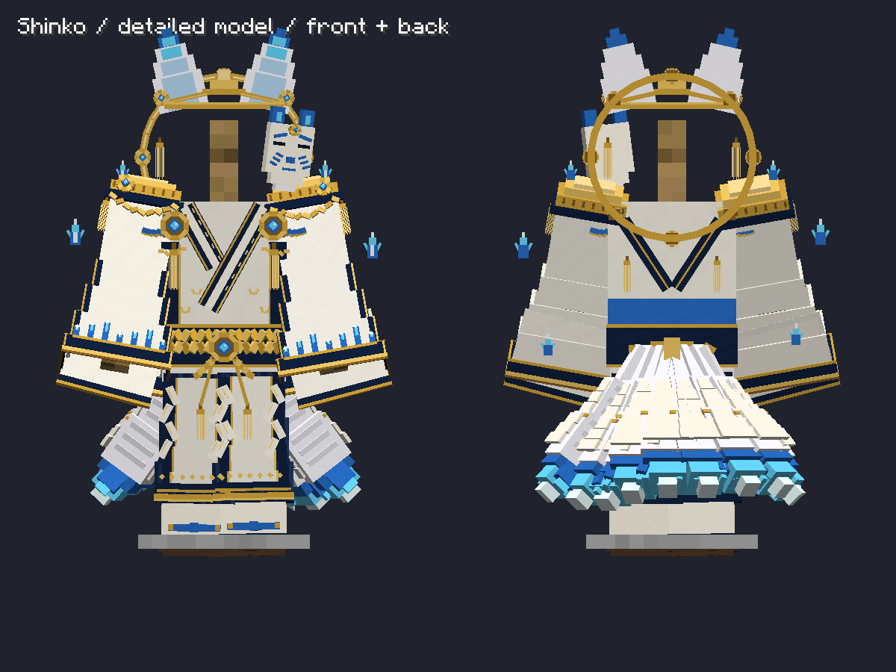
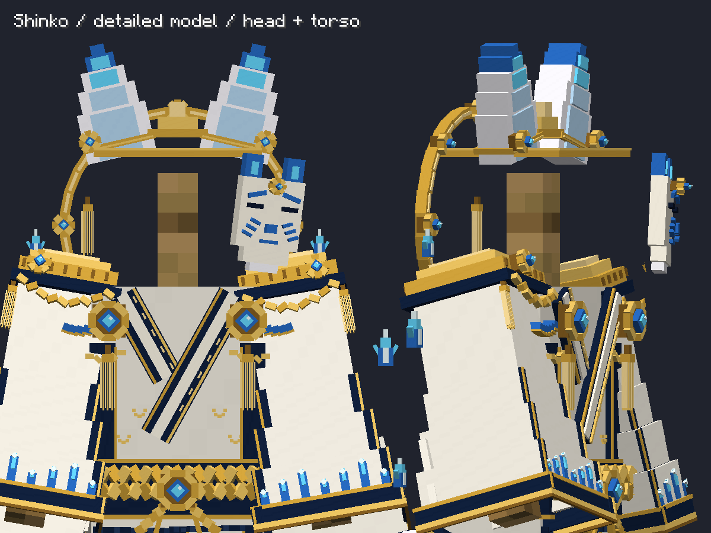
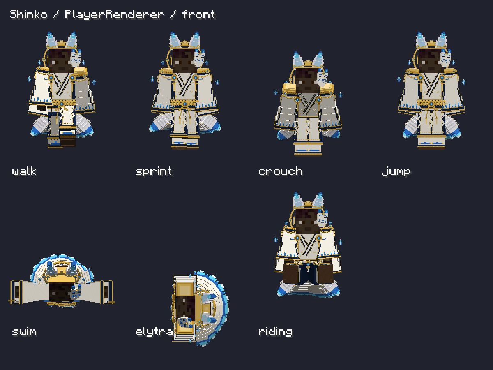

# 神狐（Shinko）専用モデル

**以降の再モデリング・最新画像・現在の立方体数は [4種再モデリング](FOUR-FOX-REFERENCE-REMODEL.md) を参照。以下の形状数・画像は初回神狐モデルの履歴。**

2026-10-21。Minecraft **1.21.1 NeoForge / Fabric**。ユーザー添付の「妖狐装備 上半身モデリング詳細案」「妖狐装備 全身モデリング詳細案」の神狐欄を参考に、独立した形状を実装した。

## 造形

編集用データは **573ボーン・1,240立方体**。NeoForge用には足の描画アンカー2個が加わる。9本すべての尻尾と装飾を含む数で、各装備スロットでは該当部位だけを描画する。

- **頭**：32分割の金輪、8か所の宝石、中央の冠、段階的に先細る青白い狐耳、金の耳飾りと房、青い隈取の白い狐面。金輪は頭の後ろに配置。
- **胸・肩**：白い内着と紺・金の重ね襟、層状の金の肩飾り、留め具、肩に渡る組紐、八角形の金枠と青い宝玉、7本に分けた房飾り。背面にも紺と金の飾り帯を追加。
- **袖**：4段階に広がる中空の袖と、後ろへ垂れる外側の袖。紺の縁取り、金の縫い目、青い狐火模様を個別に造形。手は開口部から見える。
- **腰**：2本の編み込み帯、斜めに交差する縄、中央の宝玉、結び目、垂れ下がる房、背面の結び。
- **脚・足**：裾へ広がる紺の袴、立体的な襞、白い前垂れ、金の縁、紙垂、白足袋と青い鼻緒、金を挟んだ木製の下駄。
- **尻尾**：段階的な太さ、白い毛束、金の留め飾り、青～水色～白の先端。装備数に応じ1・3・6・9本。下向きを基本とした既存の揺れを継承。
- **狐火**：頭の両側と胴の周囲に装飾用の立体狐火。胴の狐火は微小に上下する。実ブロックや攻撃判定は作らない。

256×256pxの専用UVパレットと発光マスクを用意。青い宝石の中心と狐火の芯を発光領域にした。NeoForgeはGeckoLib 4.9.3の発光レイヤー、Fabricは専用の発光描画を使う。周囲のブロックを照らす光源や、シェーダーなしのブルーム効果は追加していない。

薄い装飾にも、前回修正した非退化・余白付きUVを適用している。既存の朱狐・白狐・黒狐の形状は維持。顔と髪はプレイヤースキンを使用し、参照キャラクターの白髪や顔を防具として付加しない。

## 実装と入手

現在の共通防具クラスで、神狐4部位を登録。今回はモデル・装備描画が対象で、追加の能力・専用バランス調整・製作レシピは導入していない。既存シリーズと同じ能力・耐久・祭壇修理処理を継承する。

クリエイティブ一覧、または次のコマンドで入手可能：

```mcfunction
/give @s kitsunebi:shinko_headdress
/give @s kitsunebi:shinko_haori
/give @s kitsunebi:shinko_hakama
/give @s kitsunebi:shinko_tabi
```

6ロケールへ名称を追加。色混在時も尻尾は1回だけ描画し、袴→羽織→頭→足の順で尻尾のシリーズを決める。

## 編集・再生成

造形の原本は `generate-shinko-detailed.py`。編集用JSONと、Blockbenchで読み込めるGeckoLib JSON、Fabric用のHumanoidModel、4個のアイテムモデルを生成する。既存の共通原本JSON・パレットは上書きしない。

```powershell
python docs/v04-codex/generate-shinko-detailed.py
python docs/v04-codex/convert-shuko-gecko.py --family shinko
python docs/v04-codex/export-shinko-assets.py
.\Build.ps1 -Target neoforge-1.21.1
.\Build.ps1 -Target fabric-1.21.1
```

主要ファイル：

- `docs/v04-codex/models/shinko_detailed.json`
- `neoforge-1.21.1/src/main/resources/assets/kitsunebi/geo/shinko_armor.geo.json`
- `common-1.21.1/src/main/java/net/kafgchan/kitsunebi/client/model/ShinkoArmorVisualModel.java`
- `common-1.21.1/src/main/resources/assets/kitsunebi/textures/entity/shinko_shrine_palette.png`
- `common-1.21.1/src/main/resources/assets/kitsunebi/textures/entity/shinko_shrine_palette_glowmask.png`

## 検証

- NeoForge / Fabric：依存解決、コンパイル、実クライアント起動、ビルド成功。
- GeckoLib実描画：4シリーズ各16通りの装備・着脱、色混在、尻尾0/1/3/6/9本、UVの退化・色境界参照の回帰チェックが成功。
- NeoForge実PlayerRenderer：神狐を含む4シリーズで歩行・走行・しゃがみ・ジャンプ・水泳・エリトラ・騎乗、正面／側面／背面、標準・スリムの不透明スキンを検査して成功。
- NeoForge実ArmorStandRenderer：4シリーズ比較、神狐の正面／背面と上半身拡大を撮影し目視確認。
- Fabricネイティブ描画：神狐専用形状を含む全装備パターン、色混在、正面／側面／背面、尻尾の重複抑制が成功。

姿勢を強制設定した描画検査であり、実際の移動物理や神狐のマルチプレイヤー観測試験は今回実施していない。参照画像の布表現は立方体の重ねで構成している。

ログ：NeoForgeの `build/shinko-final.log`。結果ファイルは各検証ディレクトリの `gecko-verification.txt`、`gecko-player-poses.txt`、Fabricの `fox-armor-verification.txt`。

出力JAR：

- `releases/preview/1.21.1/neoforge/1.0.0/kitsunebi-neoforge-1.21.1-1.0.0-gecko-preview.jar`
- `releases/1.21.1/fabric/1.0.0/kitsunebi-fabric-1.21.1-1.0.0.jar`






