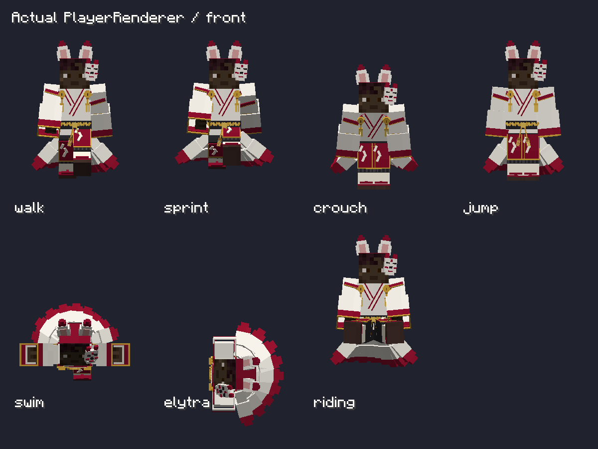

# 朱狐デザイン反映（NeoForge 1.21.1）

**最新の形状とFabric対応は [4種再モデリング](FOUR-FOX-REFERENCE-REMODEL.md) を参照。以下は2026-10-20の履歴。**

2026-10-20。利用者の追加依頼により、変換のみの仮実装から、添付詳細案の朱狐を参考にした造形調整へ進めた。

- GeckoLib：公式公開版 **4.9.3** に固定。GradleとModメタデータを一致させた。
- 仮面：頭の側面から前方へ2.1px移動。狐耳は短く幅広い先細りに変更。
- 上半身：立体的な重ね襟、肩の朱帯、鈴・房飾り、手を露出する開口を残した二重袖、朱と金の袖口。
- 腰・下半身：組紐風の帯、結び目と下がり房、紙垂、黒い袴の襞、白足袋と朱鼻緒の下駄。
- 既存の白・朱・金・黒の128pxパレットを維持。髪や顔は追加せず、プレイヤースキンを使用。
- 尻尾の既存ボーン・動き・装備数0/1/2/3/4に対する0/1/3/6/9本の判定を維持。

共通JSON・PNG・Javaモデルの原本は変更しない。変更前の変換スクリプトと派生モデルは、上位の `Kitsunebi-Archive/2026-10-20/shuko-gecko-before-detail` に保存した。Fabric・Forge向けの造形変更は今回含まない。

## 再生成

リポジトリ直下から実行：

```powershell
python docs/v04-codex/generate-shuko-detailed.py
python docs/v04-codex/convert-shuko-gecko.py
.\Build.ps1 -Target neoforge-1.21.1
```

編集用データは `models/shuko_detailed.json`、ゲーム用はNeoForgeの `assets/kitsunebi/geo/shuko_armor.geo.json`。新設ボーンは襟・鈴・組紐などの静的装飾で、既存の頭・胴・腕・脚の姿勢に追従する。アニメーション制御ボーンや別シリーズの装備は追加していない。

通常起動は `.\RunClient.ps1 -Target neoforge-1.21.1`。配布JARを通常ランチャーで使用する場合はGeckoLib 4.9.3とArchitectury APIを別途導入する。

## 検証

- 4.9.3の依存解決・Javaコンパイル・ゲーム起動・実GeoArmorRendererで全16通りの装備組み合わせと着脱時の尻尾判定：成功。
- 実PlayerRendererで標準・スリムの不透明スキン外層を重ねた描画：成功。胴と足の検査領域でスキンの露出なし。
- 歩行・走行・しゃがみ・ジャンプ・水泳・エリトラ・騎乗の姿勢fixtureで正面・側面・背面を出力。最終の襟長・肩帯調整後にも全装備組み合わせ・姿勢・スキン描画fixtureを再実行して成功。
- 詳細ログはNeoForgeの `build/detail-*.log`、画像は `build/gecko-skin-fit-client/gecko-player-poses-*.png`。

参照画像の布・編み込みはMinecraftの立方体モデルへ簡略化している。画像と完全に同じ高密度造形ではない。姿勢fixtureは描画検証であり、実際の遊泳・飛行操作のプレイテストを代替しない。

4.9.3で2つの実クライアントを専用サーバーへ接続し、観測側で全16通りの装備変更と尻尾0/1/3/6/9本の同期描画を確認して成功。

仮ビルド：`releases/preview/1.21.1/neoforge/1.0.0/kitsunebi-neoforge-1.21.1-1.0.0-gecko-preview.jar`。ビルド成功、JAR内の依存バージョン4.9.3・最終97ボーン・原本パレットSHA256一致を検証済み。


