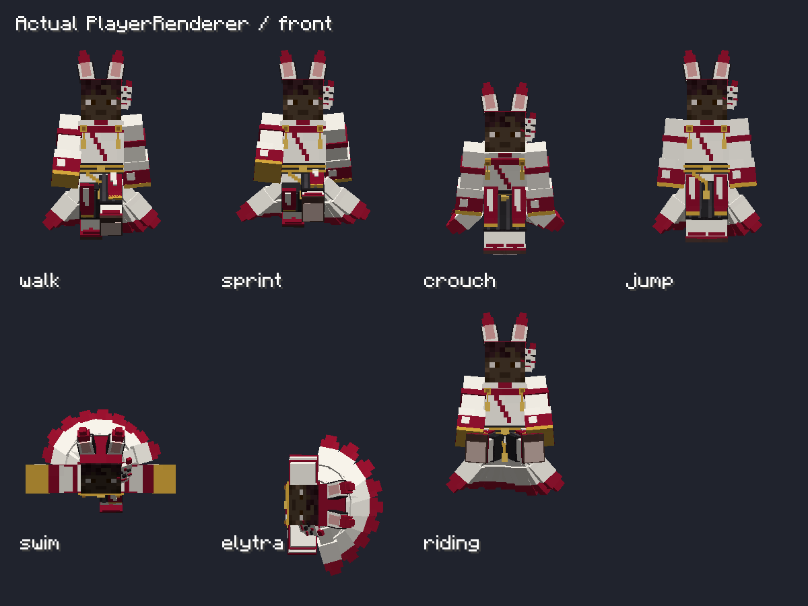

> 現在の版：GeckoLib 4.9.3。朱狐の追加造形と最新検証は [SHUKO-DETAILED-MODEL.md](SHUKO-DETAILED-MODEL.md) を参照。以下は初回変換段階（4.8.4）の記録。

# 朱狐防具 GeckoLib 仮実装 — NeoForge 1.21.1

## 対象と採用版

- Minecraft 1.21.1 / NeoForge 21.1.259 / Java toolchain 21 / Gradle Wrapper 9.7.1（実行JDK 25）。
- Architectury API 13.0.8の既存方針を維持。
- **GeckoLib 4.8.4** をNeoForgeモジュールだけで固定。依存は `software.bernie.geckolib:geckolib-neoforge-1.21.1:4.8.4`。Modメタデータでも `[4.8.4]` を必須指定。
- GeckoLibはMod本体へ同梱しない。配布JARを利用する場合は、対応するArchitectury APIとGeckoLibを別途導入する。
- 公式資料：[導入](https://github.com/bernie-g/geckolib/wiki/Installation-(Geckolib4))、[防具](https://github.com/bernie-g/geckolib/wiki/Geckolib-Armor-(Geckolib4))。実装APIは取得した4.8.4の公式sources JARも照合。

## 調査結果と変更範囲

既存の4部位は登録済み。共通の `KitsunebiArmorItem` と各部位の能力実装を継承している。
元モデルは `common-1.21.1/src/main/resources/assets/kitsunebi/codex/v04/armor_geometry.json`（独自JSON）と、その生成済みJavaモデル `client/model/KitsunebiArmorVisualModel.java`。
アトラスは `kitsunebi:textures/entity/kitsunebi_shrine_palette.png`、128×128、32×32の素材区画16個。既存の67ボーン・146直方体・耳・狐面・袖・帯・袴・足袋／下駄・9本の尻尾階層を再利用。

元のJavaモデル、JSON、PNG、生成器は変更しない。新規の造形・配色・他シリーズ・アイテムIDは追加しない。
既存の能力、祭壇、レシピ、進行、ネットワーク処理も変更しない。今回新たに能力を実装・強化するものではなく、既存能力は存続する。
Fabric・Forge・26.xにはGeckoLibを導入しない。

### 変換

`convert-shuko-gecko.py` が元JSONを読み、NeoForge専用の `geo/shuko_armor.geo.json` を追加生成。
Javaの下向きY座標と局所ピボットを、Bedrockの上向きY・絶対ピボットへ変換する。素材UV区画を維持。スキン干渉修正により、最新派生モデルでは被覆用の9直方体に最小限の外形クリアランスを追加（下記追記参照）。
GeckoLibの標準防具アンカー名へ対応付け、足部を脚装備から分離するため、空の `armorRightBoot` / `armorLeftBoot` アンカーを追加。アニメーション用の新ボーンは不要で、既存の尻尾階層を使用。
空のanimation JSONはリソース契約用。揺れは `GeoModel.setCustomAnimations` で既存の周期・扇状配置・下向きの基準姿勢を適用する。

原本JSONのSHA256：`6cacbc59edb49844d92063766c0d40e4909f3aaa6b2c9a3867e0911486ed8d20`。

## 尻尾と描画

- `ArmorTailGrowth` はPredicateで装備系列を指定でき、今回は既存の朱狐4アイテムだけを判定。将来の別系列そのものは登録しない。
- 0/1/2/3/4部位を0/1/3/6/9本へ対応付ける。全16部分集合を対象とする。
- 尻尾担当は袴→胸→頭→足の順で着用済み1部位を選ぶ。同じプレイヤーに重複描画しない。袴未装備でも描画する。
- 着用者の同期済み装備を毎描画時に参照する。新しい独自パケットやサーバー判定は追加しない。
- 尻尾は胴体アンカー配下。頭のみ・足のみでも腰位置に出し、頭／脚の回転へ誤追従させない。
- GeckoLib標準の姿勢転送に加え、元モデルの脚ピボット±1.9を補正。描画のみで当たり判定は変更しない。
- NeoForgeのclient-only Mixinが既存防具にGeoItemのアダプターを付け、標準GeckoLib GeoRenderProviderを使用。旧IClientItemExtensionsの二重登録は解除したが、旧描画ソースは保存。

## 検証

- GeckoLib 4.8.4の依存解決、NeoForgeビルド、ゲーム起動：PASS。
- 実GeckoLibレンダラーで全16装備組み合わせと解除、本数・単一描画担当、正面・側面・背面：PASS。
- 専用NeoForgeサーバー＋実クライアント2台で、観察側の通常PlayerRenderer／防具レイヤーを経由した他プレイヤーの全16装備組み合わせの表示：PASS。
- 姿勢別PlayerRenderer描画：PASS。歩行・走行・しゃがみ・ジャンプ・水泳・滑空・騎乗の7姿勢×3方向を描画。同期済みリモートプレイヤーの非追跡コピーへ姿勢を設定した検証であり、実操作・物理挙動のテストではない。
- 原本のテクスチャ・Javaモデル・JSONを保存。衝突処理には変更なし。

検証用runは通常の `run/` と分離し `neoforge-1.21.1/build/` 配下に保存する。検証クラスはsystem property指定時のみ動作する。

## ビルドと起動

```powershell
.\Build.ps1 -Target neoforge-1.21.1
.\RunClient.ps1 -Target neoforge-1.21.1

# 単独の描画検証（ワールド不要、自動終了）
.\gradlew.bat :neoforge-1.21.1:runGeckoVerifyClient -PrecipeViewer=none -PcuriosEnabled=false
```

仮実装JARは **`releases/preview/1.21.1/neoforge/1.0.0/*-gecko-preview.jar`**。
通常版と同じMod IDなので、通常版と仮実装版を同時導入しない。

## 追加・変更ファイル

- NeoForge `build.gradle`、`neoforge.mods.toml`：固定依存、仮実装JAR名、検証run。
- NeoForge `KitsunebiNeoForge.java`：旧描画拡張の登録を停止。
- NeoForge `KitsunebiNeoForgeClient.java`：明示指定時だけ動く検証フック。
- NeoForge `mixin/ShukoArmorGeoMixin.java` とclient-only Mixin JSON：既存アイテムの描画アダプター。
- NeoForge `client/gecko/ArmorTailGrowth.java`、`ShukoGeoModel.java`、`ShukoGeoRenderer.java`。
- NeoForge `assets/kitsunebi/geo/shuko_armor.geo.json`、`animations/shuko_armor.animation.json`。
- NeoForge `verification/GeckoArmorVerifier.java`、`GeckoNetworkServerVerifier.java`、`GeckoNetworkClientVerifier.java`、`GeckoPlayerPoseScreen.java`、既存 `AltarGuiVerifier.java` の描画拡張確認。
- `docs/v04-codex/convert-shuko-gecko.py`、本書、`CREDITS.md`。
- `gradle/stage-release.gradle`：明示的なreleasePreview指定で仮実装の配置先を分離。

## 残存・次段階

- 実装は既存モデルの形式変換。添付された新しい詳細案への造形の作り直しは今回行わない。
- 低遅延localhostの2クライアントで検証。遅延回線・大人数・他の描画Modとの競合は未検証。
- 袖の追加揺れ、尻尾の物理的な毛表現、装飾の独立揺れは対象外。基本的な尻尾の周期揺れと速度に応じた持ち上がりまで。
- 姿勢別描画で問題が判明した場合は、この仮実装内のアンカー・追従補正だけを調整する。


## 描画上の限界と証拠画像

モデル脱落・異常な伸長等の重大な崩れは検出しなかった。袖・裾・尻尾は既存の剛体モデルなので、大きな腕振りや騎乗時の軽微な重なりは残る。布・毛の物理シミュレーションは対象外。
原本テクスチャSHA256：`938fbabbc256c49de093723b5a227b303e7ecb44d093082b8c5b237e83c64b71`。



[側面](gecko-player-poses-side.png) / [背面](gecko-player-poses-back.png)

追記した案内ファイル：ルート `README.md`、`scripts/README.md`、`releases/README.md`、`docs/v04-codex/README.md`。仮実装の依存条件と出力先を明記。
最終JAR検査：GeckoLib固定メタデータ、Geoモデル・Mixin・レンダラーの収録、原本テクスチャのバイト一致、依存JAR非同梱、SHA256SUMS一致を確認。


## スキン外レイヤーとの干渉修正

- 胴の前面が±2.2にあり、バニラのスキン上着レイヤー（±2.25）より内側になっていた。袖・袴・足袋の一部も外レイヤーと接触・交差していた。
- 元JSON・Javaモデル・PNGは維持し、NeoForge用Geo派生データの被覆9直方体（胴、左右袖、左右袴、左右足袋、左右下駄底）だけ、0.05〜0.3モデルピクセル程度の余裕を追加。ボーン配置・装飾・色・尻尾は維持。
- スキンの顔や手、外レイヤーの表示設定を強制的に隠す処理は追加しない。
- 通常腕／細い腕の完全不透明スキンを実PlayerRendererで7姿勢×3方向描画。正面の胴と足元に検証色が露出しないことをピクセル検査し、側面・背面も画像確認。ビルドと仮実装JAR更新が成功。
- 再実行：専用検証サーバー起動後、`:neoforge-1.21.1:runSkinFitClient`。検証画像は `build/gecko-skin-fit-client/gecko-player-poses-3.png` 〜 `8.png`。マゼンタの頭は検証用スキンの意図した表示であり、missing textureではない。
